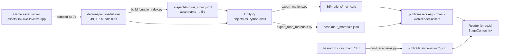
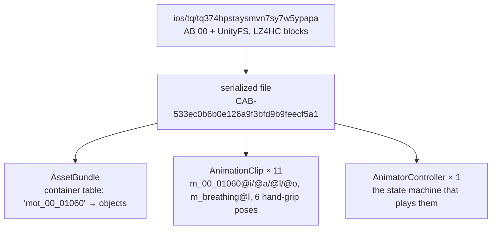
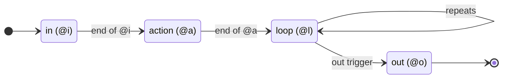

# A crash course in the game's Unity data

This is for anyone (human or agent) who needs to pull something new out of `data-inspect/` and get
it into the reader. It explains how the game's files are put together, how Unity's humanoid
animation works, and how our scripts turn it into glTF. Every number and picture comes from the
real files. Rebuild the figures with `uv run --group docs scripts/crash_course_figures.py`.

1. [The short version](#1-the-short-version)
2. [Asset bundles](#2-asset-bundles)
3. [Objects, typetrees and references](#3-objects-typetrees-and-references)
4. [Models, skeletons and the Avatar](#4-models-skeletons-and-the-avatar)
5. [Muscles](#5-muscles)
6. [AnimationClips on disk](#6-animationclips-on-disk)
7. [Root motion, the body frame and IK goals](#7-root-motion-the-body-frame-and-ik-goals)
8. [AnimatorControllers: how clips are strung together](#8-animatorcontrollers-how-clips-are-strung-together)
9. [From Unity to glTF and three.js](#9-from-unity-to-gltf-and-threejs)
10. [Recipes](#10-recipes)
11. [Glossary](#11-glossary)

## 1. The short version



- The game ships its art as **Unity asset bundles**: compressed archives of serialized Unity
  objects such as meshes, textures, materials and animation clips.
- We read them with **UnityPy** (no Unity install needed), which turns each object into a plain
  Python dict. Our scripts convert what the reader needs into web formats (glTF, JSON).
- Animation is the hard part. The game uses Unity's **humanoid** ("Mecanim") system, which stores
  *muscle values* rather than bone rotations, so we redo Unity's humanoid math ourselves
  (`scripts/unity_assets.py`). Sections 4–8 are about that.

## 2. Asset bundles

`data-inspect/` holds dumps of the game's asset server (see `data-inspect/README.md`). The part
we use most is `ios-full/ios/`: the iOS asset bundles, extracted. That's 49,007 files with
meaningless hashed names like `ios/tq/tq374hpstaysmvn7sy7w5ypapa`. **The bundle index**
(`.inspect-tmp/ios_index.jsonl`, rebuilt by `scripts/build_bundle_index.py`) maps the names the
game uses, called *containers*, to those files:

```json
{"file": "../data-inspect/ios-full/ios/tq/tq374hpstaysmvn7sy7w5ypapa",
 "cabs": ["CAB-533ec0b6b0e126a9f3bfd9b9feecf5a1"], "deps": [],
 "containers": ["mot_00_01060"],
 "types": {"AnimationClip": 11, "AssetBundle": 1, "AnimatorController": 1}}
```

### Inside one file

These are the real first bytes of that file (the motion `mot_00_01060`):

```
00000000: ab00 556e 6974 7946 5300 0000 0008 352e  ..UnityFS.....5.
00000010: 782e 7800 3230 3232 2e33 2e36 3266 3200  x.x.2022.3.62f2.
00000020: 0000 0000 0011 97d9 0000 0078 0000 00bf  ...........x....
00000030: 0000 0243 …
```

| Bytes | Meaning |
| --- | --- |
| `ab 00` | Two bytes the game puts in front. They aren't part of Unity's format: **strip them or UnityPy won't recognize the file** (`BundleIndex.load_env` does this). |
| `UnityFS\0` | Signature of Unity's bundle format. |
| `0000 0008` | Format version 8. |
| `5.x.x\0`, `2022.3.62f2\0` | Player version (always `5.x.x`) and the Unity version that built it. |
| `0011 97d9` | Bundle size, 1,152,985 bytes (the file is 2 bytes longer because of the prefix). |
| `0000 0078`, `0000 00bf` | Compressed and uncompressed size of the block table. |
| `0000 0243` | Flags: `0x03` LZ4HC compression, `0x40` block table and directory stored together, `0x200` padding before the data. |

After decompression a bundle contains one or more **serialized files** named `CAB-<hash>`. Those
hold the objects:



What the whole dump contains, counted from the index:

| Kind | Count | Notes |
| --- | ---: | --- |
| Bundles | 49,007 | |
| Story motions (`mot_*` containers) | 2,534 | one bundle each: clips + controller |
| Models (`__*.fbx` containers) | 1,193 | bodies, faces, props; their textures and materials are separate `__*.png` / `__*.mat` containers |
| Avatars | 431 | humanoid definitions, one per body rig |
| AnimationClips / AnimatorControllers | 46,141 / 2,609 | |
| Meshes / Materials / Textures | 11,629 / 42,476 / 47,083 | |
| MonoBehaviours | 307,879 | game-specific script data |
| AudioClips | 0 | audio isn't in bundles; it's in `llll-assets-raw.7z` |

### Dependencies between bundles

Objects can point at objects in *other* bundles. Kaho's body model bundle (`__scsch011kahdea.fbx`)
lists four dependencies, and they turn out to be its four materials (`…_cos_mt.mat`, `…_hair_mt.mat`,
`…_skin_mt.mat`, `…_indoorshoes_mt.mat`), one bundle each. The index's `deps` field holds the
CAB names, and `BundleIndex.by_cab` finds the bundle for each. Clips, controllers and Avatars
are self-contained, so motion work only ever needs one bundle at a time.

## 3. Objects, typetrees and references

Every object in a serialized file has a **PathID** (a 64-bit id, unique within that file) and a
**class**, for example Transform = 4, Mesh = 43, AnimationClip = 74, Avatar = 90,
AnimatorController = 91, Animator = 95. These bundles also embed each class's field layout, the
**typetree**, so UnityPy can read any object as a nested dict without knowing the class in
advance:

```python
import sys; sys.path.insert(0, "scripts")
import unity_assets as UA

index = UA.BundleIndex(".inspect-tmp/ios_index.jsonl")
env = index.load_env("mot_00_01060")          # finds the file, strips AB 00, opens it
for obj in env.objects:
    print(obj.path_id, obj.type.name)          # AnimationClip ×11, AnimatorController, AssetBundle
clips = UA.objects_of_type(env, "AnimationClip")   # list of typetree dicts
```

Run code like this with `uv run python -I`, because the dump is untrusted input.

A field that refers to another object is a **PPtr**: `{m_FileID, m_PathID}`. `m_FileID` 0 means
"this file"; otherwise it's a 1-based index into the file's list of external CABs (the `deps`).

## 4. Models, skeletons and the Avatar

A character body comes from an FBX the artists exported, stored as container
`__scsch011kahdea.fbx` for Kaho in her school uniform. Inside are 197 GameObjects, each with a
**Transform** (local position, rotation and scale relative to its parent). There are also six
**SkinnedMeshRenderers** with their **Meshes**, an **Animator**, and an **Avatar**.

**Skinning.** Each vertex is attached to up to four bones with weights, and moves with them:
`v' = Σ wᵢ · boneᵢ(world) · bindposeᵢ⁻¹ · v`. The weights tell you a lot. For example, the skirt
has no bones of its own. It's skinned to the hips (42%) and the two upper legs (26% each), which
is why a high knee lift pushes the thigh through it.

**The Avatar** says which Transform plays which role in a standard human body. That's what lets
one animation drive any humanoid character.


Kaho's rig doesn't use Unity's bone names: `KahDeA_LArm` is the left upper arm and
`KahDeA_Spine_03` is the upper chest. The Avatar maps 24 body bones (Jaw is unused) and 30 finger
bones. The other 143 Transforms aren't part of the humanoid at all, and humanoid animation never
moves them. Instead, the assembled costume prefab bundle (`3d_costume_1001103101`, which depends on
`__scsch011kahdea.fbx`) attaches 58 `MonoBehaviour` components that drive them at runtime:
- **6 `MagicaCloth2.MagicaCloth` (`BoneCloth`, `clothType: 1`)** components simulate the `SP_*`
  spring-bone chains for front/back/side hair, necktie, and collar.
- **1 `MagicaCloth2.MagicaCloth` (`MeshCloth`, `clothType: 0`)** component simulates the boneless
  skirt at the vertex level (using prebuilt cloth data in `__magicaprebuild_scsch011kahdea.asset`)
  against **15 `MagicaCapsuleCollider` / `MagicaSphereCollider`** body colliders on the hips, upper
  and lower legs, torso, arms, and head — preventing the thighs from poking through the skirt.
- **`Inspix.SubBoneController`** (configured by `__subbone_gate4_scs_base.asset`) procedurally
  drives 42 roll, bend, and slide helper bones (`*BendHalf`, `*Roll`, `*RollHalf`, `*Slide`,
  `*ElbowSub*`, `*UpLegSub*`, `*KneeSub*`) as linear fractions of the parent limb bone rotations.

For each human bone the Avatar stores (`m_Avatar.m_Human.m_Skeleton.m_AxesArray`):

| Field | What it is |
| --- | --- |
| `m_PreQ`, `m_PostQ` | Rotations that convert between the bone's own local frame and a standard "muscle frame": x along the bone (twist), y and z the two bend axes. |
| `m_Sgn` | Per-axis sign, so left and right sides mirror. |
| `m_Limit.m_Min/m_Max` | The angle range each muscle covers (radians). Kaho's Left Arm Down-Up is −60° … 100°; her Left Forearm Stretch is −80° … 80°. |

It also stores a reference pose, a mass per bone (used for the centre of mass) and the **human
scale**. Kaho's human scale is 0.874; root positions in clips are measured in multiples of it.

## 5. Muscles

A humanoid pose is **95 numbers**, mostly between −1 and +1: 55 body muscles and 40 finger
muscles. Each muscle is one rotational degree of freedom of one bone. Unity's names spell out
the direction, for example "Left Arm Down-Up" or "Head Nod Down-Up". `UA.MUSCLE_NAMES` lists
them in channel order.


Note that **0 is the middle of the range, not the T-pose and not a natural standing pose**.
With Left Arm Down-Up at 0 the arm hangs about 45° out from the body.

Turning a muscle value into a bone rotation (`axes_unproject` in `unity_assets.py`):

1. Map it to an angle: `m ≥ 0 ? m · max : −m · min` (`min` is negative), per axis.
2. Turn the bone's three angles (twist x, bends y and z) into a rotation using half-angle
   tangents `h = tan(sgn · angle / 2)`:
   `q = normalize(hx, hy + hx·hz, hz − hx·hy, 1)`. Unity calls this a "ZY roll".
3. The bone's local rotation is `preQ · q · conj(postQ)`.

Bones without muscles keep their rest rotation.

## 6. AnimationClips on disk

A humanoid clip leaves Unity's ordinary curve lists empty (`m_RotationCurves`,
`m_PositionCurves`, … all have 0 entries). Everything is in `m_MuscleClip.m_Clip`, as three
blocks of curves, always in this order:

| Block | Storage | In `m_00_01060@a` |
| --- | --- | --- |
| Streamed | Keyframes. The data is a flat array of 32-bit words: frames of *(time, key count, then per key: curve index + 4 coefficients)*. Each key starts a cubic segment `v = ((c0·dt + c1)·dt + c2)·dt + c3`, where `dt` is time since the key and `c3` is the value at the key. A first frame at time −3.4·10³⁸ acts as a start sentinel. | 123 curves |
| Dense | Values sampled on a fixed frame grid. | 0 curves |
| Constant | One value per curve, for channels that never change. | 7 curves |

`m_ClipBindingConstant.genericBindings` has one entry per curve, in the same order. For humanoid
clips every entry is `typeID 95` (Animator), and its `attribute` is the **channel number**:

| Attribute | Channel |
| --- | --- |
| 0–6 | MotionT / MotionQ (not used in these clips) |
| 7–9 | RootT: body position (section 7) |
| 10–13 | RootQ: body orientation |
| 14–41 | IK goals: LeftFoot, RightFoot, LeftHand, RightHand, each position xyz + rotation xyzw |
| 42–96 | the 55 body muscles (`42 + index in MUSCLE_NAMES`) |
| 97–136 | the 40 finger muscles (per hand and finger: 1 Stretched, Spread, 2 Stretched, 3 Stretched) |

`decode_clip` samples all three blocks on the clip's frame grid (30 fps here) and returns
`(times, values[channel, frame], attributes)`.


A motion's four clips are **consecutive slices of one take**, and the frame at each cut isn't
repeated. `@a`'s first frame is the frame after `@i`'s last (for Left Forearm Stretch, 0.6256 is
followed by 0.5288). So they join seamlessly when played back to back, which is how the
controller plays them.

## 7. Root motion, the body frame and IK goals

**RootT/RootQ aren't the hips.** RootT is the body's **centre of mass**: the mass-weighted
average of each bone segment's midpoint. RootQ is a **body orientation**: "up" runs from the
midpoint of the upper legs to the midpoint of the upper arms, and "right" from the left leg and
arm to the right ones. Both are measured relative to the character's root, with RootT in units of the
human scale.

To place the hips, `HumanoidBaker.bake` poses the skeleton with the hips at the origin. It
computes where that puts the centre of mass (`com`) and body frame (`bodyQ`), then moves the hips
so those land on the clip's values:

```
hipsQ = RootQ · conj(bodyQ)
hipsT = RootT · scale − hipsQ · com
```

**IK goals** are where Unity's IK would put the hands and feet, also stored per frame in every
clip. The game may use them for IK touch-ups. **We use them as an answer key**: bake the muscles,
run forward kinematics, and measure how far the wrist lands from the hand goal. (Foot goals sit
at the sole rather than the ankle bone, so only hands are compared.) That's
`export_motions.py --check`, and it needs nothing outside data-inspect. Across the 580 main clips
of episode 1, the mean error per clip has a median of 0.3 cm, 90% are under 1.9 cm, and the worst is 2.8 cm. The raised-arm pose below is one of the harder ones, at 0.8 and 1.5 cm.


## 8. AnimatorControllers: how clips are strung together

Each motion bundle has its own AnimatorController. Here's `mot_00_01060`'s, dumped with UnityPy:

| Layer | Plays | Blending | Default weight |
| --- | --- | --- | --- |
| 0 (base) | the state machine below | override | 1 (the base layer always is) |
| 1 | a synchronized copy of layer 0 with the IK pass on | override | 0 |
| 2 | `m_breathing@l`, looping | **additive** | **0.5** |
| 3, 4 | left and right hand-grip poses (`gripsize0/1/2`) | override | 0 |



Every arrow is an instant cut: exit time 1.0 (the clip's end) and a 0-second blend.

The controller has a single parameter, the `out` trigger. A story command like
`[キャラモーション再生 綴理 mot_00_01140 2]` starts the motion at `in`. It plays `@i` and `@a`
once, then loops `@l` until something else happens. Many `@l` clips are just the held end pose,
so a player that only plays `@l` skips the gesture entirely. The game's code (see CLAUDE.md,
"The game's code") explains the arguments. The third is the start state: `0` = `in`, `1` = `loop`,
`2` = `action`. So the usual `2` starts at `@a` and skips `@i`. The optional fourth is the breathing
layer's weight (0.2 if omitted). `キャラモーション即時再生` ("play immediately", 213 uses, none in
episode 1) jumps to normalized time `<4th arg>` within that state, with no blend.


All 144 controllers episode 1 uses have exactly this base layer, and every motion is a round trip:
`@o` ends where `@i` starts, in one of a few shared neutral poses (standing, seated, running).

The reader reproduces the base layer in `src/engine/storyMotion.ts` (branch `motion-sequencing`)
rather than blending clips freely. One clip plays at a time. When it ends the next one starts,
carrying over the leftover time, as a 0 s transition does. `@i → @a` play once, then `@l` loops,
and a line that's jumped to mid-motion goes straight to `@l`. How the game switches between two
*different* motions is in its code, not the data (each motion has its own controller). The game
runs two AnimatorControllerPlayables (current and next) through an `AnimationMixerPlayable` and
crossfades their weights over **0.5 s**. It plays the old motion's `@o` first only when the new
motion starts in `in` (play type 0). The reader currently freezes the pose on screen and blends
over 0.28 s, a guess that predates the code dump. The additive breathing layer isn't reproduced
yet.

## 9. From Unity to glTF and three.js

**Handedness.** Unity is left-handed and glTF is right-handed, so one axis gets mirrored. Model
data (bones, motions, costumes) is converted by negating x: position `(−x, y, z)`, rotation
`(x, −y, −z, w)`. Stage placement from the story scripts is converted with `(x, y, −z)` and yaw
`180 − ry` (`StageCanvas.tsx`). The two agree: mirroring z is mirroring x followed by a 180° turn
about y, and that turn is the `180 −` in the yaw formula.

**Motion GLBs** (`export_motions.py`) contain Kaho's full rig, built from the Avatar's skeleton
with the same node names as the costume GLBs. There's one glTF animation per clip: a rotation
track for every muscle-driven bone plus a translation track for the hips. Clips keep their Unity
names (`m_00_01060@i`, …, `m_breathing@l`, grip poses).

**Retargeting.** We bake on Kaho's Avatar. For other characters, `retargetMotionClips` renames
the tracks to their bone prefix (`KahDeA_*` → `<Chr>DeA_*`). Unity instead solves the muscles on
each character's own Avatar, and scales root motion by that body's size. Copying the bone
rotations by name turns out to match a per-character solve almost exactly; the hips position
doesn't. Copied unscaled, it put Kozue 10.5 cm too low, with her feet through the floor. So the
hips translation is scaled by the ratio of the two rigs' rest hip heights. That brings every
character's hands, feet and head to within about 1 cm of the per-character solve.

**Proof.** Side by side, here's what the reader showed while these motions were missing, and the
exported motions played in the controller's order. The video is
[motion-proof.mp4](https://storage.googleapis.com/hasu-web-reader-docs/docs/media/motion-proof.mp4); this is one still per motion. Each pose matches
the motion's description in `3d/metadata/motions.json`, and `mot_00_01140` 「後頭部をなでる」 is
Tsuzuri stroking Sayaka's head in 103-ep1-part2: she turns to her left, where Sayaka stands.


## 10. Recipes

**Find the bundle for an asset**

```bash
grep '"mot_00_01060"' .inspect-tmp/ios_index.jsonl
```

**List a bundle's objects and dump one as JSON**

```bash
uv run python -I - <<'EOF'
import json, sys
sys.path.insert(0, "scripts")
import unity_assets as UA
env = UA.BundleIndex(".inspect-tmp/ios_index.jsonl").load_env("mot_00_01060")
for obj in env.objects:
    print(obj.path_id, obj.type.name)
ctrl = UA.objects_of_type(env, "AnimatorController")[0]
print(json.dumps(ctrl["m_Controller"]["m_LayerArray"], indent=1, default=str)[:2000])
EOF
```

**Export the motions a new episode uses**

```bash
uv run scripts/export_motions.py --scripts 10300201 10300202 --check
scripts/upload_assets_gcs.sh public/assets/3d/motions
npm run build-scenarios
```

**Look at a motion without a browser**

```bash
uv run scripts/render_motion_preview.py mot_00_01280 --out /tmp/run.mp4
```

**Rebuild this document's figures**

```bash
uv run --group docs scripts/crash_course_figures.py
```

## 11. Glossary

| Term | Meaning |
| --- | --- |
| Asset bundle | Unity's archive format (`UnityFS`): compressed blocks holding serialized files. |
| CAB | A serialized file inside a bundle, named `CAB-<hash>`. Cross-bundle references use these names. |
| Container | The name the game loads an asset by (`mot_00_01060`), listed in the bundle's AssetBundle object. |
| PathID / PPtr | An object's id within its file / a reference to an object (`m_FileID` + `m_PathID`). |
| Typetree | The field layout of a class, embedded in the file; lets UnityPy read objects as dicts. |
| Transform | Position, rotation and scale relative to the parent; bones are Transforms. |
| Skinning / bind pose | Moving mesh vertices with weighted bones / the pose the mesh was attached in. |
| Avatar | Maps a rig's Transforms to human bones and stores per-bone frames, limits and masses. |
| Humanoid / Mecanim | Unity's system for animation that transfers between human-shaped rigs. |
| Muscle | One normalized degree of freedom of one human bone, mostly −1 … +1. |
| preQ / postQ | Per-bone rotations between the bone's local frame and its muscle frame. |
| RootT / RootQ | Body centre of mass and orientation, the humanoid "root" of a clip. |
| IK goal | Where IK would place a hand or foot; doubles as our validation target. |
| Streamed / dense / constant | The three curve storage blocks of a muscle clip. |
| AnimatorController | State machine that decides which clips play, with layers and parameters. |
| Exit time / trigger | Transition when a clip reaches a normalized time / a one-shot parameter (`out`). |
| Additive layer | A layer whose clip is added on top of the layers below (breathing at 0.5). |
| Spring bone (`SP_*`) | A secondary-motion bone (hair, cloth) simulated at runtime, not animated by clips. |

## What still comes from elsewhere

Motions in the store are now exported from data-inspect. Costume GLBs, props, backgrounds, voice,
BGM and SE are still older hamproductions-derived exports. Re-exporting them from data-inspect is
the remaining work; CLAUDE.md lists the rules.
